# High-Density Object Segmentation

**Instance segmentation and object counting in crowded scenes: a fine-tuned YOLOv8s-seg, two classical baselines, and a density-aware hybrid, all scored in one reproducible evaluation on COCO.**

[](https://huggingface.co/spaces/Pranay004/high-density-object-segmentation)


Pranay Sarkar · Newton School of Technology

---

## Live demo

**▶ [huggingface.co/spaces/Pranay004/high-density-object-segmentation](https://huggingface.co/spaces/Pranay004/high-density-object-segmentation)**

The fine-tuned model runs **entirely in your browser** through ONNX Runtime Web, so nothing is uploaded. Drop in a crowded photo and the page shows the detector alone next to the density-aware hybrid, along with each one's object count and latency.

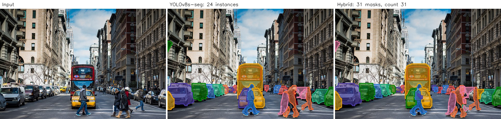

<sub>COCO val2017 test image 373353, which has 34 ground-truth objects. The detector alone finds 24. The density gate fires (edge density 0.262), and the relaxed second pass brings the count to 31. These are real model outputs from `weights/yolov8s-seg-dense.pt`. The counts match this image's record in `results/metrics/unified_results.json`.</sub>

---

## The problem

**High-density segmentation** means finding and outlining *every* object instance in a scene with many of them: a parked street, a dinner table, a crowd. Each object gets its own pixel mask. The count follows directly from the masks.

**Who needs it:** retail shelf auditing, crowd and traffic monitoring, warehouse and agricultural counting, and any pipeline where "how many, and where" matters more than one label for the whole image.

**Why it's hard:**

- **Occlusion and touching objects.** Neighbouring instances overlap, so their boundaries are ambiguous.
- **Non-maximum suppression assumes overlap means duplication.** In a crowd that assumption is wrong, and a detector tuned for ordinary scenes suppresses real objects.
- **Classical methods have no object prior.** Thresholding and colour clustering split pixels by intensity or colour, not by object. They merge touching objects or shatter one object into many regions.
- **IoU alone can mislead.** A method that sprays many masks can score decent overlap while getting the count badly wrong (see KMeans below).

This project measures those failure modes on COCO images with **5–50 non-crowd objects**. It then tests whether gating a relaxed second detector pass on a cheap crowding signal beats the detector alone.

---

## Visual results

Each row shows the input, then fine-tuned YOLOv8s-seg (conf 0.25, NMS IoU 0.45), then the hybrid. One colour per instance. All three images are held-out test images, and they are the samples the live demo ships with.

| Test image | GT objects | YOLOv8s-seg | Hybrid | Edge density |
|---|---|---|---|---|
| 373353 (street) | 34 | 24 | **31** | 0.262 |
| 114884 | 33 | 23 | **25** | 0.188 |
| 9590 (dinner table) | 29 | 18 | **25** | 0.122 |

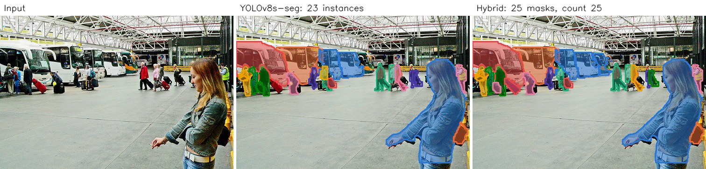

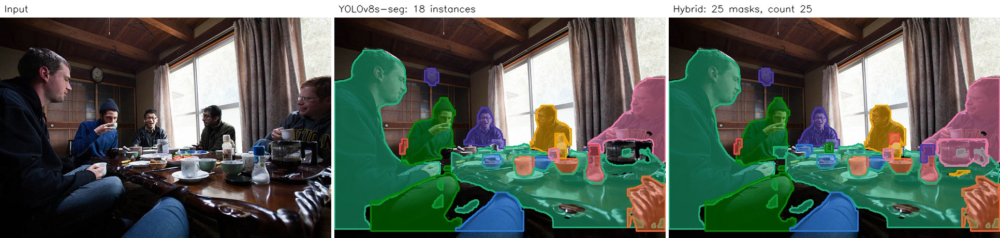

<sub>Generated by running the committed checkpoint on CPU over `space-static/samples/`. The predicted counts and edge densities match the per-image records of the GPU evaluation run exactly. The third image also shows a real failure: the dining table and the person behind it are partly merged into one mask.</sub>

---

## Dataset

| | |
|---|---|
| **Source** | [COCO 2017](https://cocodataset.org/) **val2017** images and `instances_val2017.json` instance annotations |
| **Density filter** | images with 5–50 non-crowd annotations → **2,463** qualifying images |
| **Subset** | **500** images, sampled uniformly at random without replacement under seed `1337` |
| **Splits** | **400 train / 50 val / 50 test**, with no overlap between splits (image IDs in `results/metrics/data_split.json`) |
| **Test-set density** | **12.64** ground-truth objects per test image on average |
| **Format** | COCO polygons converted to YOLO segmentation labels across 80 classes (`src/prepare_yolo_data.py`) |
| **Licence** | The repo doesn't redistribute COCO; you download it yourself. COCO's annotations are published under CC BY 4.0, and the images are subject to Flickr's terms ([COCO terms of use](https://cocodataset.org/#termsofuse)). |

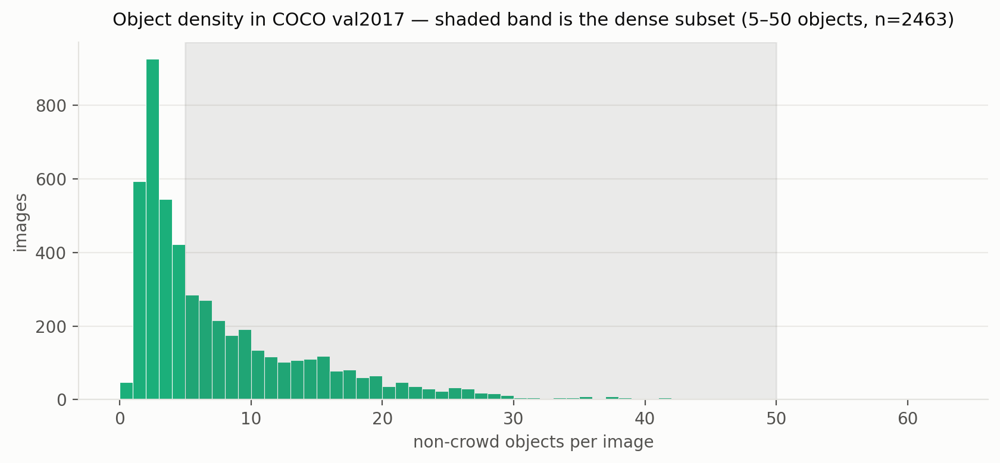

---

## Pipeline

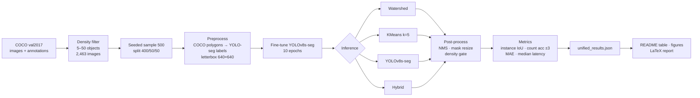

All four methods are scored in **one process, on the same 50 test images, with the same metric code** (`src/evaluate.py`). Every table and figure is generated from that single output file.

---

## Model architecture

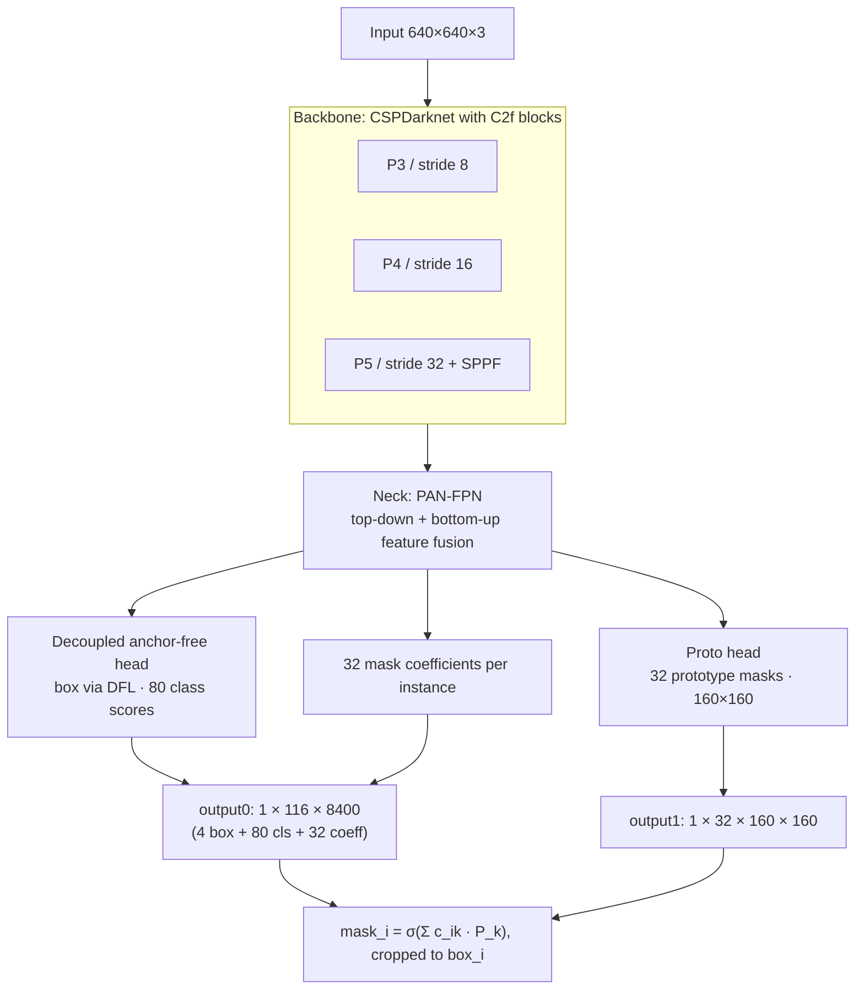

**In plain English.** The **backbone** (CSPDarknet with C2f blocks) turns the image into feature maps at three scales, so both small and large objects are represented. The **neck** (PAN-FPN) mixes those scales top-down and bottom-up, so each level carries both detail and context. The **head** is anchor-free. At every location of the three grids (80² + 40² + 20² = 8,400) it predicts a box, 80 class scores and 32 mask coefficients. In parallel, a **proto head** produces 32 shared prototype masks. Each instance's mask is a sigmoid of its 32 coefficients applied to those prototypes, cropped to its box. That is how one network emits a variable number of masks.

**Loss.** Fine-tuning uses the Ultralytics YOLOv8 segmentation loss, a weighted sum of four terms (gains from the checkpoint's `train_args`):

| Term | What it penalises | Gain |
|---|---|---|
| Box (CIoU) | box overlap, centre distance and aspect-ratio error | 7.5 |
| DFL (distribution focal loss) | the box-edge distribution, which sharpens localisation | 1.5 |
| Classification (BCE) | class scores against task-aligned targets | 0.5 |
| Segmentation (per-pixel BCE) | each instance's assembled mask against its ground-truth mask, inside its box | 7.5 |

**The hybrid sits on top of the trained model and adds no new weights:**

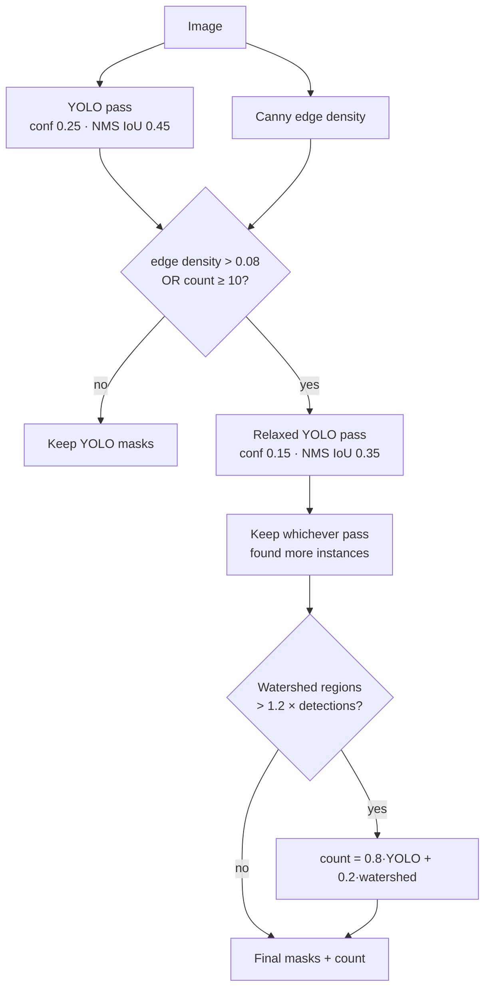

The gate measures crowding with **Canny edge density, not the detector's own count**. If the detector has already missed the crowd, its count can't be what tells you a crowd is there.

---

## Training setup

| | |
|---|---|
| **Hardware** | Google Colab, single NVIDIA T4 GPU (`notebooks/colab_pipeline.ipynb`). Provenance records `device=cuda`, torch 2.11.0+cu128. |
| **Base weights** | `yolov8s-seg.pt` (COCO-pretrained), fine-tuned on the 400-image dense train split |
| **Schedule** | 10 epochs, image size 640, batch 16, optimizer `auto`, lr0 0.01, weight decay 0.0005, 3 warm-up epochs, AMP, patience 20, seed 1337, deterministic |
| **Augmentations** | HSV jitter (h 0.015, s 0.7, v 0.4), translate 0.1, scale 0.5, horizontal flip 0.5. Mosaic is configured (1.0) but **never actually ran**: `close_mosaic=10` equals `epochs=10`, so Ultralytics disables it from epoch 0. |
| **Checkpoint** | `weights/yolov8s-seg-dense.pt` (23.9 MB), plus an ONNX export for the browser demo |

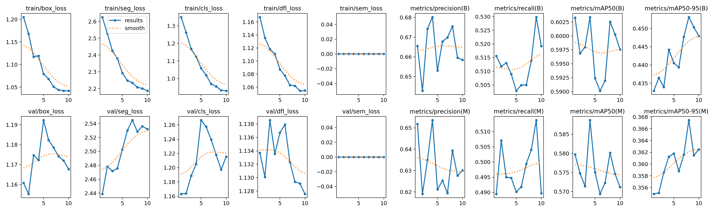

**Validation metrics of the saved checkpoint** (best epoch, 50 val images, read from the checkpoint's `train_metrics`):

| | Precision | Recall | mAP@50 | mAP@50-95 |
|---|---|---|---|---|
| Box | 0.676 | 0.514 | 0.603 | 0.453 |
| Mask | 0.639 | 0.504 | 0.580 | 0.367 |

---

## Evaluation

**Metrics**, all defined once in `src/metrics.py`:

- **Mean instance IoU.** Class-agnostic, with greedy one-to-one matching between predicted and ground-truth masks. Unmatched ground-truth objects score 0, so missing objects is penalised.
- **Count accuracy (±3).** The share of images where |predicted − true count| ≤ 3.
- **Count MAE.** Mean absolute counting error per image.
- **Latency.** Median and interquartile range after warm-up, never a mean over a cold start.

<!-- RESULTS:BEGIN -- generated by scripts/update_readme.py, do not edit -->

| Method | Type | Mean IoU | Count acc. (±3) | MAE | Median latency |
|---|---|---|---|---|---|
| Watershed | Classical | 0.065 | 28% | 8.66 | 13 ms <sub>(IQR 11–17)</sub> |
| KMeans (k=5) | Classical | 0.252 | 0% | 114.86 | 88 ms <sub>(IQR 70–110)</sub> |
| YOLOv8s-seg (fine-tuned) | Deep learning | 0.429 | 52% | 4.28 | 26 ms <sub>(IQR 24–30)</sub> |
| Hybrid (density-aware) | Hybrid | **0.456** | **64%** | **3.30** | 62 ms <sub>(IQR 54–71)</sub> |

<sub>All four methods scored in a **single run** on the same 50 held-out test images, with the same metric definitions, on the same device — `cuda`, seed `1337`, 2026-09-22. Instance IoU is class-agnostic under greedy one-to-one matching; unmatched ground-truth objects score 0 and are included in the mean. Latency is a median with an interquartile range, not a mean over a cold start. torch 2.11.0+cu128, ultralytics 8.4.38, weights `yolov8s-seg-dense.pt`.</sub>

<sub>The hybrid's density gate fired on **41 of 50** test images; the watershed cross-check then altered the count on **4** of them.</sub>

<!-- RESULTS:END -->

The table above is generated from `results/metrics/unified_results.json` by `scripts/update_readme.py`. Running `--check` fails if it goes stale.

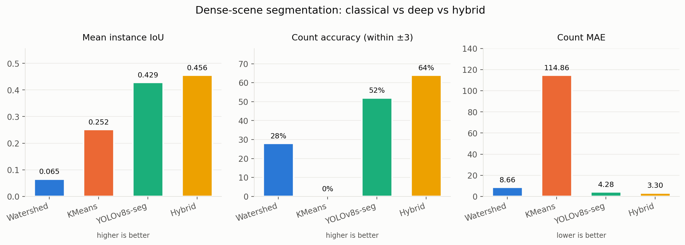

**How to read it:**

- **The hybrid improves counting much more than mask quality.** Compared with YOLO alone, count accuracy goes from 52% to 64% and MAE from 4.28 to 3.30. Mean IoU moves only from 0.429 to 0.456, because the hybrid's masks still come from a YOLO pass.
- **KMeans shows why IoU alone isn't enough.** It reaches 0.252 IoU while getting the count right on *zero* images. It emits **127.5 masks per image against 12.64 real objects**, so greedy matching finds overlap by volume.
- **Watershed under-counts.** It averages 4.22 masks per image, because Otsu thresholding assumes a bimodal intensity histogram that natural photos don't have.

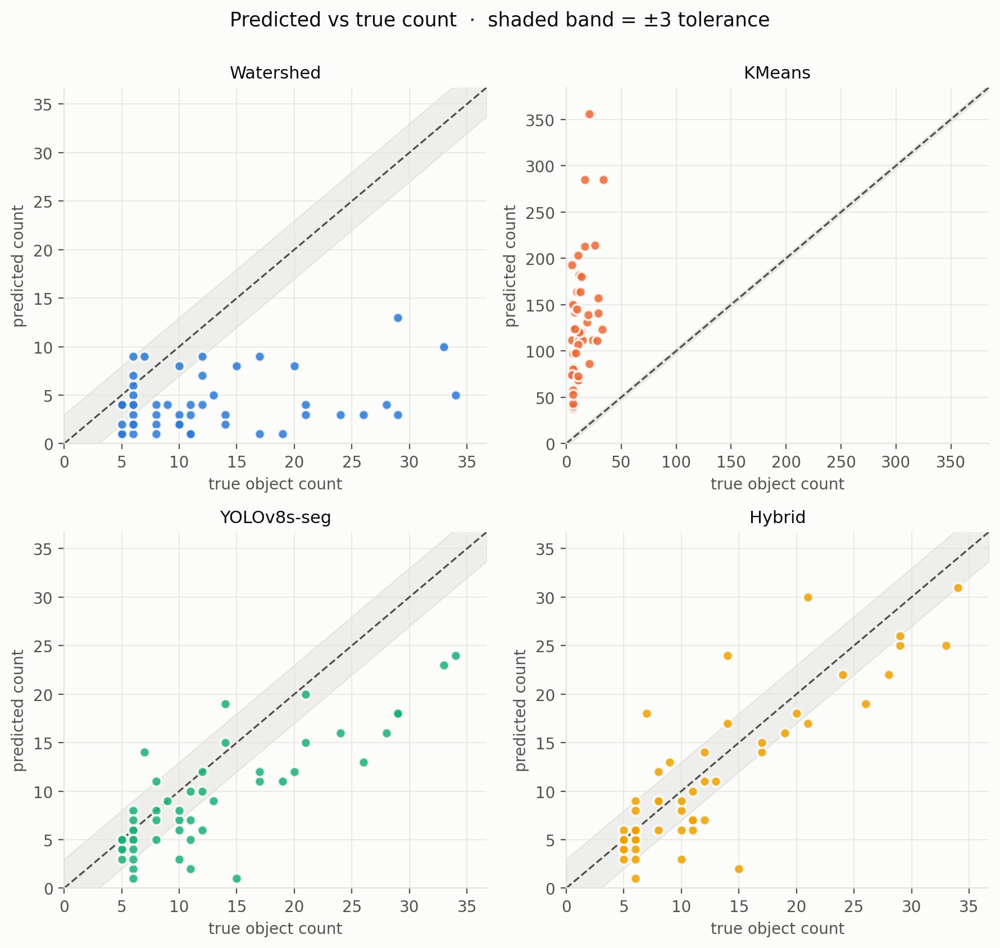

### Ablation: which half of the hybrid does the work?

`src/ablation.py` splits the hybrid's gain between its two mechanisms:

| Mechanism | Images it fired on | Count error removed |
|---|---|---|
| Density-gated relaxed detector pass | 41 / 50 | **46 objects** |
| Watershed cross-check | 4 / 50 | **3 objects** |

The classical cross-check contributes **6.1%** of the improvement. So the method is more accurately described as **density-aware two-pass detection with a marginal classical correction**. On the 9 images where the gate didn't fire, the hybrid's MAE (2.56) is identical to YOLO's, so the gate costs nothing when it isn't needed.

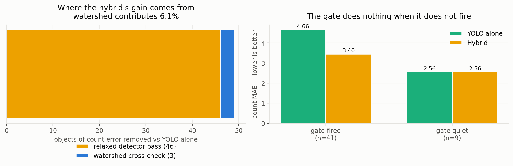

---

## Tech stack

| Part | Tool | Why it was used |
|---|---|---|
| Data | **pycocotools** | Reads COCO annotations and decodes polygons and RLE into the ground-truth masks used for scoring |
| Data | **NumPy, OpenCV** | Image I/O, polygon → YOLO label conversion, mask resizing |
| Model / training | **Ultralytics YOLOv8s-seg** | A single-stage instance-segmentation model with COCO-pretrained weights, small enough to fine-tune on a T4 in one session |
| Model / training | **PyTorch** | The backend for Ultralytics training and inference |
| Classical baselines | **OpenCV, scikit-learn** | Watershed (Otsu, distance transform) and KMeans colour clustering, as non-learned reference points |
| Evaluation | **Custom harness** (`src/evaluate.py`, `src/metrics.py`) | One IoU and one counting definition applied to all four methods in one run |
| Evaluation | **Matplotlib, pandas** | Figures and tables regenerated from the results file |
| Reporting | **nbformat / nbconvert, LaTeX** | Notebooks and an 18-page report (`report/main.pdf`) whose numbers are generated macros |
| Demo app | **ONNX Runtime Web + vanilla JS** | Runs the exported model client-side with no server or GPU cost, and no image upload. Pre/post-processing (letterbox, NMS, prototype masks, Canny gate) is reimplemented in `space-static/yolo.js`. |
| Deploy | **Hugging Face Spaces (static SDK)** | Free hosting for a static page, with large-file storage for the 47 MB ONNX model |

---

## Project structure

```
src/             experiment code: config, data prep, training, baselines, hybrid, metrics, evaluation, ablation, figures
scripts/         generators that write results into the README, the report and the notebooks
notebooks/       EDA, methods/results, and a one-click Colab notebook for the full pipeline
results/         metrics JSON/CSV (single source of every number), figures and training curves
weights/         fine-tuned checkpoint (.pt) and its ONNX export
space-static/    the deployed browser demo (HTML/JS + ONNX model + sample images)
space/           an alternative Gradio version of the demo (not the deployed one)
report/          LaTeX source and compiled 18-page PDF report
docs/images/     README visuals generated from the committed checkpoint
```

---

## Getting started

Tested with **Python 3.12**. The NumPy pin (2.0.2) has no wheels for Python 3.13.

```bash
git clone https://github.com/Zakuroooo/high-density-object-segmentation.git
cd high-density-object-segmentation
python3.12 -m venv .venv
.venv/bin/pip install torch torchvision      # pick the wheel for your CUDA / CPU / MPS
.venv/bin/pip install -r requirements.txt
```

**Get COCO val2017** (about 1 GB of images plus the annotations):

```bash
mkdir -p data && cd data
curl -LO http://images.cocodataset.org/zips/val2017.zip
curl -LO http://images.cocodataset.org/annotations/annotations_trainval2017.zip
unzip -q annotations_trainval2017.zip -d annotations
mkdir -p images && unzip -q val2017.zip -d images && cd ..
```

**Train, evaluate, regenerate:**

```bash
export PYTHONPATH=src
.venv/bin/python src/prepare_yolo_data.py   # seeded dense subset + YOLO labels
.venv/bin/python src/train.py               # fine-tune (GPU recommended)
.venv/bin/python src/evaluate.py            # all four methods, one run
.venv/bin/python src/ablation.py            # decompose the hybrid's gain
.venv/bin/python src/figures.py             # figures from the results file
.venv/bin/python scripts/update_readme.py   # regenerate the results table
```

The fine-tuned checkpoint is committed, so `evaluate.py` doesn't need retraining. With no local GPU, `notebooks/colab_pipeline.ipynb` runs the whole pipeline on a free Colab T4.

**Run the demo locally:**

```bash
python3 -m http.server 8099 --directory space-static
# open http://localhost:8099  (ONNX Runtime Web loads from the jsDelivr CDN)
```

<sub>Verification for this README: on a CPU-only machine without COCO access, the install succeeded. `ablation.py`, `figures.py` and both `--check` scripts ran and reproduced the committed outputs. `train.py`, `prepare_yolo_data.py` and `evaluate.py` started and stopped at the missing-data check, as expected. The static demo served all its assets. Full training and evaluation were not re-run.</sub>

---

## Key decisions and challenges

| Challenge | Fix |
|---|---|
| An earlier version printed numbers from two different runs (different models, sample sizes and devices) as one table | A single harness (`src/evaluate.py`) scores every method on one test set in one run. All tables and figures are generated from its output, and `--check` scripts catch drift. |
| The classical baselines returned only a count, so the IoU numbers published for them had no masks behind them | Both baselines now return instance masks, scored by the same function as YOLO |
| The subset was the 500 lowest COCO image IDs, which is a biased sample | A seeded uniform sample from all 2,463 dense images, with the split IDs committed |
| A mean latency was dominated by one 12.7 s cold start | Warm-up before timing, with median and IQR reported |
| A blanket `*.pt` gitignore meant the trained weights were lost | The checkpoint is committed (`weights/`), with a `.gitignore` exception |
| Training on an 8 GB M2 could only fit 512 px / batch 2 and swapped heavily | Moved training to a Colab T4 at 640 px / batch 16 |
| Crowds suppress real detections through NMS | A cheap Canny edge-density gate triggers a relaxed second pass only on crowded scenes |
| Pixel-clustering baselines have no class labels | Every method is scored class-agnostically, so all four share one scale |
| The demo needed to be free to host and fast to start | The model was exported to ONNX and post-processing ported to JS, so it runs in the browser on a static Space |

---

## Limitations and future work

**Limitations**

- **The test split is 50 images.** That's enough to show the classical-versus-deep gap, but not enough to prove the hybrid-versus-YOLO margin. Treat that margin as a direction.
- **Fine-tuned on COCO, evaluated on COCO.** The base model was already COCO-pretrained, so this measures adaptation to dense scenes, not generalisation to a new domain.
- **Class-agnostic scoring.** A correct mask with the wrong label still counts as a hit.
- **Single-polygon labels.** COCO objects annotated as several disjoint polygons keep only their largest part, because of the YOLO label format.
- **Mosaic augmentation never ran** (see Training setup), and the model trained for only 10 epochs. The validation mask losses rose over training (see the training curves), so the checkpoint is far from tuned.
- **The browser demo omits the watershed cross-check.** It would need OpenCV compiled to WebAssembly, for a component the ablation shows contributes 6.1% of the gain. The demo also uses single-threaded WASM, so it's slower than the GPU latencies above.
- **The hybrid can raise its count without adding masks.** When the watershed blend fires, the count and the number of drawn masks can differ.

**Future work**

- A larger, cross-validated test split to put confidence intervals on the hybrid's margin.
- Longer training with mosaic actually enabled (`close_mosaic` < `epochs`).
- Evaluation on a genuinely dense, out-of-domain dataset, such as retail-shelf or crowd-counting benchmarks.
- Class-aware COCO mAP for the deep methods alongside the class-agnostic comparison.
- Learning the gate thresholds on the validation split instead of using fixed values.

---

## Citation

```bibtex
@misc{sarkar2026hdos,
  author = {Pranay Sarkar},
  title  = {High-Density Object Segmentation: Classical, Deep Learning, and Hybrid Approaches},
  year   = {2026},
  url    = {https://github.com/Zakuroooo/high-density-object-segmentation}
}
```
